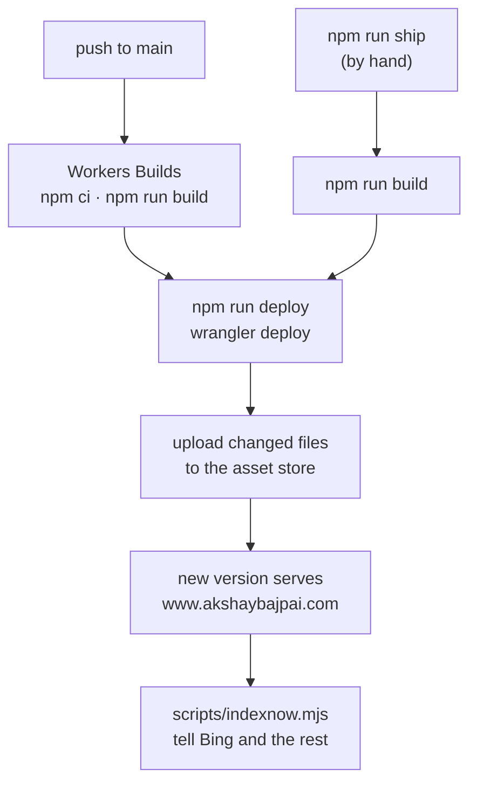
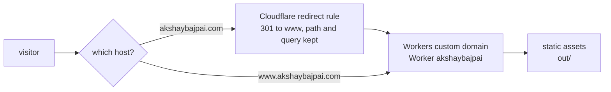

<div align="center">

# Deployment

**How the set gets from a commit to [www.akshaybajpai.com](https://www.akshaybajpai.com).**

Static files, built and served by Cloudflare, for free.


</div>

```
┌────────────────────────────────────────────────────────────────────────────┐
│  DEPLOYMENT RUNBOOK                            SHEET   C-701    REV    C   │
│  Drawing set · Akshay Bajpai                   HOST    Cloudflare          │
│  Source of truth: wrangler.jsonc                                           │
└────────────────────────────────────────────────────────────────────────────┘
```

> [!NOTE]
> **Rev C, 2026-11-12: moved from GitHub Pages to Cloudflare.** GitHub Actions stopped
> starting the Pages deploy (runs sat queued with no jobs and could be neither cancelled
> nor re-run), so the set now deploys with Wrangler as Workers static assets, which is
> Cloudflare's current home for Pages sites. `.github/workflows/deploy.yml` is gone. The
> GitHub Pages site still exists at `ax5hay.github.io/akshaybajpai.com` but no DNS record
> points at it.

## At a glance

| | |
|:--|:--|
| **Live URL** | https://www.akshaybajpai.com |
| **Host** | Cloudflare Workers static assets, Worker `akshaybajpai`, account `a03b65e14fa160528953a7cdb7b8625b`. No Worker script: every request is a file lookup, and none is billed |
| **Trigger** | A push to `main` once Workers Builds is connected to the repository ([§7](#7--one-time-setup)); until then, `npm run ship` from a checkout of `main` |
| **Time to live** | Seconds after the upload; only changed files are sent |
| **What is deployed** | The `out/` directory from `npm run build`: static HTML, CSS, JS, fonts, plus `_headers` |
| **Server-side code** | None. No functions, no database, no secrets |
| **Cost** | Nothing for hosting, builds or the certificate. The domain registration is the only bill |
| **Third-party runtime service** | Formspree, for the contact form |

## Contents

1. [How a deploy works](#1--how-a-deploy-works)
2. [What gets built](#2--what-gets-built)
3. [Domain, DNS and HTTPS](#3--domain-dns-and-https)
4. [Day to day](#4--day-to-day)
5. [Verifying a deploy](#5--verifying-a-deploy)
6. [Rolling back](#6--rolling-back)
7. [One-time setup](#7--one-time-setup)
8. [Filing with the search engines](#8--filing-with-the-search-engines)
9. [Troubleshooting](#9--troubleshooting)
10. [Known limits](#10--known-limits)

---

## 1 · How a deploy works



| Step | What it does |
|:--|:--|
| `npm run build` | `next build`, then the feed and `llms.txt`, the share cards and the polyfill strip ([§2](#2--what-gets-built)) |
| `wrangler deploy` | Reads `wrangler.jsonc`, hashes every file in `out/`, uploads only the ones Cloudflare does not already have, and makes the new version live on the Worker and its custom domain in one step |
| `node scripts/indexnow.mjs` | Waits for the key file to be live, then POSTs every URL in `out/sitemap.xml` to IndexNow. Warns, never fails ([§8](#8--filing-with-the-search-engines)) |

`npm run deploy` is the last two; `npm run ship` is all three.

**`wrangler.jsonc`, the only deploy config:**

| Key | Value | Why |
|:--|:--|:--|
| `assets.directory` | `./out` | The static export |
| `assets.html_handling` | `auto-trailing-slash` | Matches `trailingSlash: true`: `/about` redirects to `/about/`, files keep their names |
| `assets.not_found_handling` | `404-page` | Anything missing gets `404.html` (X-999) with a real 404 status |
| `routes` | `www.akshaybajpai.com`, `custom_domain: true` | The Worker is the origin for `www`; Cloudflare owns its DNS record and certificate |
| `workers_dev` | `true` | Also served at `akshaybajpai.akshaybajpai-com.workers.dev`, useful for checking a deploy before DNS |

**`public/_headers`** gives the content-hashed files under `/_next/static/` a year's
`immutable` cache. Pages and everything else are revalidated on every visit
(`max-age=0, must-revalidate`), so a deploy shows at once.

---

## 2 · What gets built

`next.config.ts` sets `output: 'export'`, so the build produces plain files and no server.

```
out/
├── index.html                  # G-000, the key plan
├── about/ · architecture/ · research/ · contact/
├── work/ · blog/ · essays/     # each: index.html + one folder per sheet
│   └── <slug>/
│       ├── index.html          # the sheet
│       └── index.txt           # its payload, fetched on client navigation
├── set/index.html              # the whole set as one document, for print
├── card/index.html             # C-701, the calling card behind the printed card's QR code
├── card/rosette.svg            # the card's guilloché engraving, from lib/card-art.ts
├── card/art/*.svg              # the engraving baked per mode, and the foil in three phases
├── akshay-bajpai.vcf           # the contact as a vCard, from lib/card.ts; what "Save contact" hands a phone
├── 404.html                    # X-999, Sheet Not Issued
├── _next/static/               # hashed JS, CSS and self-hosted fonts
├── sitemap.xml                 # from app/sitemap.ts, with each sheet's real issue date
├── robots.txt                  # from app/robots.ts
├── rss.xml · llms.txt          # from scripts/generate-rss.mjs: one feed of every sheet, and the set described for models
├── og/<sheet>.png              # from scripts/generate-og.mjs: one share card per sheet
├── og.jpg · logo.png · favicon.svg · site.webmanifest · humans.txt
└── _headers                    # from public/: a year's cache on /_next/static/*
```

| Setting | Value | Consequence |
|:--------|:------|:------------|
| `output` | `'export'` | Static files only; nothing can run on a server |
| `trailingSlash` | `true` | Every route is a folder with an `index.html`; `html_handling` serves it at the clean URL |
| `images.unoptimized` | `true` | No image optimisation service exists on a static host |

The export is 33 HTML pages and about 7.5 MB in total, most of it the per-sheet payloads and
the fonts.

**Fonts are self-hosted.** `next/font` downloads Instrument Serif and IBM Plex at build
time and ships them from `_next/static/media/`. The live site makes no request to Google.

**The polyfill bundle is not shipped.** `next build` emits `polyfills-*.js` for browsers
without module support and marks it `nomodule`. `scripts/strip-polyfills.mjs` removes the
tag from every page and deletes the file, since no browser that needs it can show the site.
If a page ever appears with the tag, that step did not run: check the build log for
*Stripped the polyfill script from N of N pages*.

**The share cards are drawn, not uploaded.** `scripts/generate-og.mjs` renders a
1200 × 630 card for every sheet with [satori](https://github.com/vercel/satori) and
`@resvg/resvg-js`, from the same frontmatter that makes the page, in the three faces
vendored under `scripts/fonts/`. The build log says *Drew N share cards into out/og/*; N
should equal the number of sheets minus one (the key plan keeps `public/og.jpg`). The
resvg binary is a platform-specific optional dependency; `package-lock.json` pins the
Linux x64 build a Linux builder needs, so do not prune optional dependencies from it.

**The calling card and its vCard are built like any sheet.** `app/card/page.tsx` is the
page the printed card's QR code resolves to, and `app/akshay-bajpai.vcf/route.ts` is a
static route handler that writes the contact as a vCard, both from `lib/card.ts`;
`app/card/rosette.svg/route.ts` writes the card's engraving the same way. Cloudflare
serves `.vcf` as `text/x-vcard`, which iOS and Android open into the address book. The
QR code itself is a Vistaprint dynamic code on vqr.vc that forwards to the bare address;
the site recognises a scan on arrival and sends it to the card (see README C-704), so
nothing has to change on vqr.vc or on the printed cards.

**The set's voice is static too.** `lib/voice.ts` holds every phrase at three levels;
server components emit all three and `html[data-mode]` shows one, so a change of level
is a CSS change and the export carries no per-level pages.

**Every page carries the sheet register.** `components/sheet/Register.tsx` is rendered by
the layout as a hidden `<nav>` listing all thirty-six sheets, so a crawler finds the whole
set from any page it lands on. It adds about 6 kB of HTML per page and nothing on screen.

**Search-engine verification is a build variable.** The build reads
`GOOGLE_SITE_VERIFICATION` and `BING_SITE_VERIFICATION` from its environment (Workers
Builds build variables) into `app/layout.tsx`, which issues the ownership `<meta>` tags when they are
set and nothing when they are not. See [§8](#8--filing-with-the-search-engines).

---

## 3 · Domain, DNS and HTTPS



| Record or rule | Value | Purpose |
|:-------|:---------------|:--------|
| Nameservers | `bailey.ns.cloudflare.com`, `damiete.ns.cloudflare.com` | DNS is managed in Cloudflare (zone `2fed72b2860ebb0734b1c7747d656b72`) |
| `www` | Workers custom domain, managed by Cloudflare | Created when the domain was attached to the Worker. Do not add a `www` record by hand: Cloudflare refuses to attach a custom domain over an existing record |
| Apex `akshaybajpai.com` | Proxied `A` records (GitHub's old Pages addresses, never reached) plus a **Single Redirect** rule, *Apex to www, path and query kept* | `301 → https://www.akshaybajpai.com<path>?<query>` at the edge |
| `http://` on either host | `301` to `https://` | Cloudflare's *Always Use HTTPS* |
| MX, SPF, DKIM, DMARC, verification `TXT` | Unchanged | Mail (Google Workspace) and the Search Console Domain property |

**The certificate** for `www` is issued and renewed by Cloudflare with the custom domain.
Nothing needs doing.

**The repository's `CNAME` file** was for GitHub Pages and is no longer read by anything.

---

## 4 · Day to day

### Publishing a change

```bash
git checkout -b my-change
# edit
npm run build            # the same build the deploy runs; catches type errors before the PR
git commit -am "…" && git push -u origin my-change
gh pr create --fill
gh pr merge --merge      # with Workers Builds connected, this is the deploy
```

Until Workers Builds is connected, deploy by hand after merging:

```bash
git checkout main && git pull
npm run ship             # build, upload, ping IndexNow
```

### Publishing writing

Add a Markdown file under `content/blog/`, `content/essays/` or `content/work/` and merge
it. The sheet is numbered, and added to the key plan, the index, the sitemap and (for blog
posts) the RSS feed, with no other change. See
[Content pipeline](README.md#s-202--content-pipeline).

### Watching a deploy

```bash
npx wrangler deployments list     # the last ten, newest first
```

Or the Worker's **Deployments** tab in the Cloudflare dashboard, which also shows Workers
Builds logs once it is connected.

---

## 5 · Verifying a deploy

```bash
# The newest deployment is yours
npx wrangler deployments list | head -12

# The site answers, over HTTPS, from Cloudflare
curl -sI https://www.akshaybajpai.com/ | grep -iE '^HTTP|^server'

# The apex and plain HTTP both redirect to the canonical host
curl -sI https://akshaybajpai.com/      | grep -iE '^HTTP|^location'
curl -sI http://www.akshaybajpai.com/   | grep -iE '^HTTP|^location'

# The supporting files are there
for p in sitemap.xml robots.txt rss.xml llms.txt humans.txt og.jpg og/about.png akshay-bajpai.vcf; do
  curl -s -o /dev/null -w "%{http_code}  $p\n" "https://www.akshaybajpai.com/$p"
done

# An unknown path returns the X-999 sheet with a real 404 status
curl -s -o /dev/null -w "%{http_code}\n" https://www.akshaybajpai.com/no-such-sheet/

# Hashed assets are cached for a year
css=$(curl -s https://www.akshaybajpai.com/ | grep -o '/_next/static/css/[^"]*\.css' | head -1)
curl -sI "https://www.akshaybajpai.com$css" | grep -i '^cache-control'
```

Then look at it:

- [ ] Open the site in a **new tab or a private window**, so the cover sheet plays.
- [ ] The cover counts up, offers **Skip intro · Enter the set**, and lifts.
- [ ] Click a sheet on the key plan; it grows into its page.
- [ ] Press <kbd>D</kbd> twice; both other modes render.
- [ ] Open one case study and operate its schematic.
- [ ] Press <kbd>/</kbd>; the index opens with a preview beside the list.
- [ ] On a phone, or a narrow window: the pile scrolls, the dock is at the foot, and on an
      article the section strip rides under the rail.
- [ ] Open `/set/` and print to PDF; every sheet starts a new page.
- [ ] Follow a link to a path that does not exist; the unissued sheet offers the nearest ones.
- [ ] Paste a sheet's URL into a chat or social app; its own card appears, not the home card.

---

## 6 · Rolling back

Every deploy is a version of the Worker, and any of the recent ones can be put back
in seconds without a build:

```bash
npx wrangler deployments list           # find the version that was good
npx wrangler rollback <version-id>       # serve it again
```

> [!WARNING]
> After a rollback the live site no longer matches `main`, and the next deploy replaces
> it again. Use it to buy time, then land a proper revert:
> `git revert -m 1 <merge-sha>` on `main` and deploy.

---

## 7 · One-time setup

Done for this site except where marked. Recorded for a fork, or for rebuilding from nothing.

1. **Worker.** `npx wrangler deploy` from the repository creates the Worker
   `akshaybajpai` from `wrangler.jsonc`. Wrangler 4.160 and later route
   `wrangler pages project create` to Workers; do not use `--force` to make a classic
   Pages project.
2. **Custom domain.** Delete any existing `www` record, then let the deploy attach
   `www.akshaybajpai.com` (the `routes` entry), or add it under the Worker's
   **Settings → Domains & Routes**.
3. **Apex redirect.** Rules → Redirect Rules → a Single Redirect: when hostname equals
   `akshaybajpai.com`, dynamic redirect to
   `concat("https://www.akshaybajpai.com", http.request.uri.path)`, status 301, preserve
   the query string. The apex needs a proxied record for the rule to run; the old `A`
   records serve that purpose.
4. **Deploy on push: not yet connected.** Workers & Pages → `akshaybajpai` → Settings →
   **Build** → **Connect**, authorise the Cloudflare GitHub app for `ax5hay/akshaybajpai.com`,
   then:

   | Field | Value |
   |:--|:--|
   | Branch | `main` |
   | Build command | `npm run build` |
   | Deploy command | `npm run deploy` |
   | Root directory | `/` |
   | Non-production branch builds | Off |

   The GitHub authorisation is a browser sign-in, which is why it could not be done from
   the command line. After that, every push to `main` builds and deploys, and
   `npm run ship` is only needed for an out-of-band deploy.
5. **IndexNow key.** `public/<key>.txt`; public by design ([§8](#8--filing-with-the-search-engines)).

No secrets are stored in the repository. Workers Builds creates its own deploy token when
it is connected.

<details>
<summary><b>Changing the domain</b></summary>

<br/>

| Where | What |
|:------|:-----|
| `wrangler.jsonc` | `routes[0].pattern` |
| `lib/constants.ts` | `SITE_URL`, used for canonical URLs, the sitemap, the structured data and share cards |
| `scripts/generate-rss.mjs` | `SITE`, used for feed links and `llms.txt` |
| `scripts/generate-og.mjs` | The domain printed on every card |
| `scripts/indexnow.mjs` | `HOST` |
| Cloudflare | The apex redirect rule's target |

</details>

---

## 8 · Filing with the search engines

The build does everything a static site can do to be found ([README, sheet
C-703](README.md#c-703--visibility)). What it cannot do is prove to Google and Bing that
the site has an owner; that needs a token from each console, and the owner's hand. Once,
about fifteen minutes in all. Bing's index also feeds DuckDuckGo, Yahoo, Ecosia and the
search layers of Copilot and ChatGPT, so the second console matters more than it looks.

How the token reaches the page: the build reads two environment variables (Workers
Builds build variables, or exported before `npm run ship`), and `app/layout.tsx` issues `<meta name="google-site-verification">` and
`<meta name="msvalidate.01">` when they are set. Neither is a secret; a verification token
is public by design, so they need not be stored as secrets.

### Google Search Console

> [!NOTE]
> **Already done for akshaybajpai.com.** A *Domain* property exists, verified through a
> DNS record at Cloudflare; it covers `www`, the apex, `http` and `https` together, and
> no `GOOGLE_SITE_VERIFICATION` variable is needed. Start at *Verify and submit*, step 10,
> and give the sitemap as its full URL, which a Domain property requires. The steps
> below are recorded for a fork, or for a property that has to be made again.

**Create the property**

1. Open [search.google.com/search-console](https://search.google.com/search-console) and
   sign in with the Google account that should own the site.
2. Property selector (top left) → **Add property**.
3. Choose the **URL prefix** card, not *Domain*. Enter exactly
   `https://www.akshaybajpai.com/` — scheme, `www`, trailing slash — and **Continue**.
   *Domain* would need a DNS TXT record at Cloudflare; *URL prefix* lets the page verify
   itself.
4. In *Verify ownership*, under *Other verification methods*, expand **HTML tag**. It
   shows `<meta name="google-site-verification" content="…" />`. Copy only the value
   inside `content="…"` (about 43 characters). The dialog can be closed; nothing is lost.

**Hand the token to the build**

5. In Cloudflare: Workers & Pages → `akshaybajpai` → Settings → **Build** → *Variables*.
6. Add `GOOGLE_SITE_VERIFICATION`, value the token.
7. Deploy: push any commit, or `GOOGLE_SITE_VERIFICATION=… npm run ship`.
8. Confirm the tag is live:

   ```bash
   curl -s https://www.akshaybajpai.com/ | grep -o '<meta name="google-site-verification"[^>]*>'
   ```

   If it prints nothing, the variable did not reach the build.

**Verify and submit**

9. Back in Search Console, **Verify**. *Ownership verified* → **Go to property**.
10. **Sitemaps** (left menu) → *Add a new sitemap* →
    `https://www.akshaybajpai.com/sitemap.xml` → **Submit**. Status should read
    *Success*, 35 discovered URLs, within minutes to a day.
11. **URL Inspection** (left menu, or the search bar at the top) → paste
    `https://www.akshaybajpai.com/` → **Request indexing**. Repeat for `/about/`,
    `/work/`, `/research/` and the newest essays. This is the one control that
    genuinely shortens the first crawl; the quota is about ten a day.
12. **Settings → Users and permissions** → add a second owner (another address of yours)
    so the property cannot be lost with one account.
13. **Pages** (under *Indexing*) → read the *Not indexed* reasons. *Discovered* or
    *Crawled – currently not indexed* is queue time. *Alternate page with proper
    canonical tag* on the apex or on `/set/` is correct. Anything else is worth a look.

What to expect: a first crawl within one to three days; the name query ranking within one
to three weeks; the **Performance** report filling after about 48 hours of data. Under
**Enhancements**, *Breadcrumbs*, *Articles* and *Sitelinks searchbox* appear once the
structured data has been read; green there means the graph parsed.

### Bing Webmaster Tools

**The short way, if Google is done**

1. Open [bing.com/webmasters](https://www.bing.com/webmasters) and sign in — with the
   same Google account used for Search Console, so the import can see it.
2. Choose **Import your sites from GSC** → **Import** → authorise → tick
   `akshaybajpai.com` → **Import**. Verification and the sitemap come over; a Domain
   property imports like any other. Skip to *Then, either way*.

**The long way**

3. **Add your site manually** → `https://www.akshaybajpai.com/` → **Add**.
4. Of the three verification methods choose **HTML Meta Tag**. Copy the value inside
   `content="…"` of `<meta name="msvalidate.01" …>` (32 hexadecimal characters).
5. Add the build variable `BING_SITE_VERIFICATION`, value the token, as for Google.
6. Deploy. Confirm:

   ```bash
   curl -s https://www.akshaybajpai.com/ | grep -o '<meta name="msvalidate.01"[^>]*>'
   ```

7. Back in Bing, **Verify**.

**Then, either way**

8. **Sitemaps** → **Submit sitemap** → `https://www.akshaybajpai.com/sitemap.xml`.
9. **URL Submission** → paste the key plan and the five most important sheets, one per
   line → **Submit**. Bing allows ten a day and usually indexes them within hours.
10. IndexNow is wired into the deploy (next section), so after the first ping the
    **IndexNow** report in the left menu shows every submission; manual URL submission
    is only for a page that needs to jump the queue.

### IndexNow, on every deploy

[IndexNow](https://www.indexnow.org/) is the protocol Bing, Yandex, Naver and Seznam
share for being told about a change rather than finding it; Bing's index then carries it
to DuckDuckGo and the Copilot and ChatGPT search layers. Google does not take it and
reads the sitemap instead.

`npm run deploy` ends with `node scripts/indexnow.mjs`:

1. The key file is `public/<key>.txt`, so every build ships it at `/<key>.txt`. IndexNow
   fetches it to prove the key belongs to the host; it is public by design, which is why
   it is committed.
2. After `wrangler deploy`, the script waits for the key file to be live, reads
   `out/sitemap.xml`, and POSTs every URL in it to `api.indexnow.org`.
3. `200` or `202` is success and is printed. Anything else is a warning, never a
   failure: a missed ping costs a crawl, not the site.

The key was generated with `openssl rand -hex 16`. To rotate it, replace the file in
`public/` with a new `<key>.txt` holding the new key, and deploy. Bing Webmaster Tools →
**IndexNow** shows what has been received.

### Leave alone

In both consoles: *Removals*, *Change of address*, *Crawl rate* and any *disavow* tool.
The defaults are right for a static site, and each of those can only make it less
visible.

### Rotating or removing a token

Delete the build variable and deploy; the tag is no longer issued. The
consoles keep the property verified for a while and then ask again, at which point a
new token goes in the same way.

---

## 9 · Troubleshooting

| Symptom | Likely cause | Fix |
|:--------|:-------------|:----|
| **Build fails with a type error in a file you did not touch** | A stray, untracked `.ts` or `.tsx` file locally. `tsc` checks every file in the tree, tracked or not | Delete or fix the stray file. A clean checkout is unaffected |
| **Build fails locally at the export step** | Something is holding `out/` open, usually a preview server | Stop the server, build, start it again |
| **`wrangler deploy`: hostname already has externally managed DNS records** | A `www` record was added by hand | Delete it; the deploy re-attaches the custom domain |
| **Deployed, site unchanged** | A browser holding the old HTML | Pages are `max-age=0`, so a reload settles it |
| **A new post is missing** | `draft: true` in its frontmatter, or a missing `title`, `description` or `pubDate` | Fix the frontmatter, merge and deploy |
| **A sheet's number changed** | Detail sheets are numbered by publication date, so adding or re-dating one renumbers the series | Expected. Link to sheets by URL, not by number |
| **Contact form fails** | Formspree is unreachable or its endpoint changed | The form already tells the visitor to email instead. The endpoint is in `components/plate/CorrespondenceForm.tsx` |
| **A hint note never appears** | Each is shown once per browser, ever, and "No more notes" turns them off | Clear `plate.notes` and `plate.notes.off` from the site's local storage |
| **The cover sheet does not appear** | It plays once per tab session, and never under reduced motion | Open a new tab or a private window |

---

## 10 · Known limits

| Limit | Effect |
|:------|:-------|
| **No server** | Anything dynamic has to be a third-party service called from the browser, as the contact form is |
| **Deploy on push needs Workers Builds connected** | Until it is, a merge does not deploy; run `npm run ship` |
| **One production site** | There is no staging copy; `main` is production. The `workers.dev` URL serves the same version |
| **Asset limits** | 25 MiB per file and 20,000 files per version; the set is far under both |

---

<div align="center">

<sub>Back to the <a href="README.md">README</a> · Config: <a href="wrangler.jsonc"><code>wrangler.jsonc</code></a></sub>

</div>
